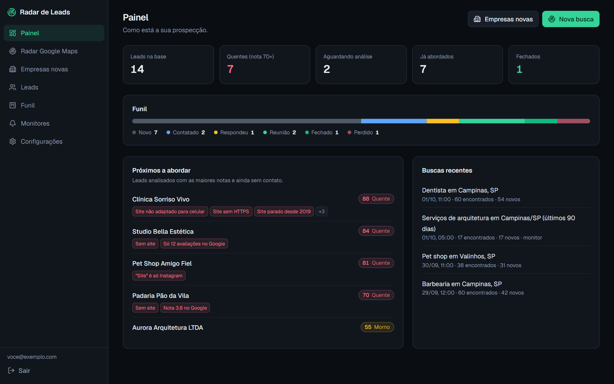
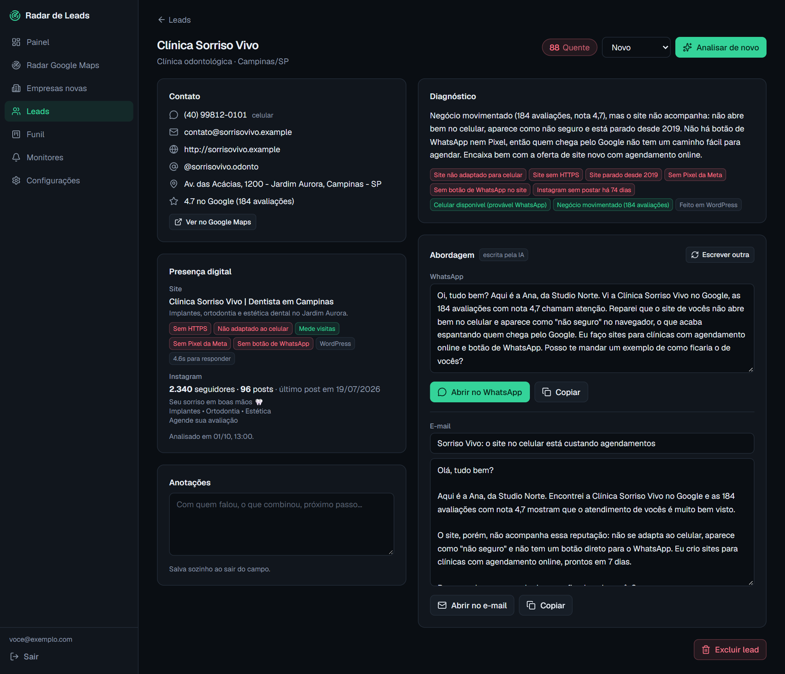
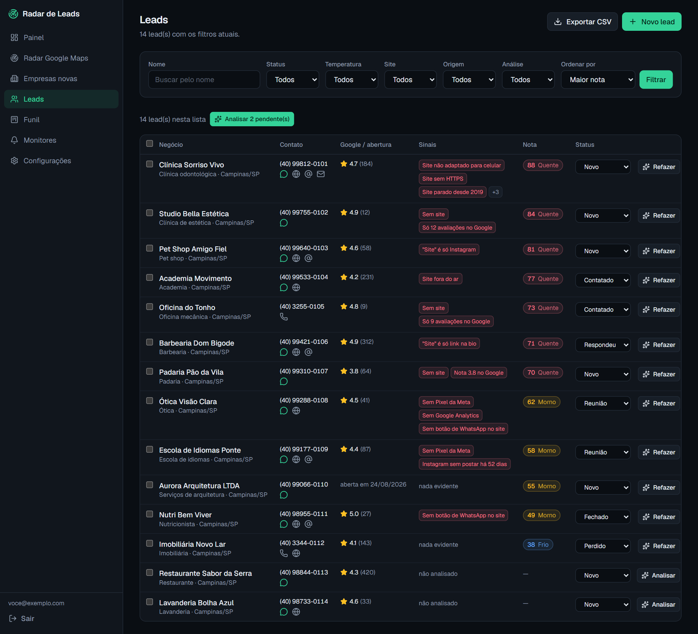
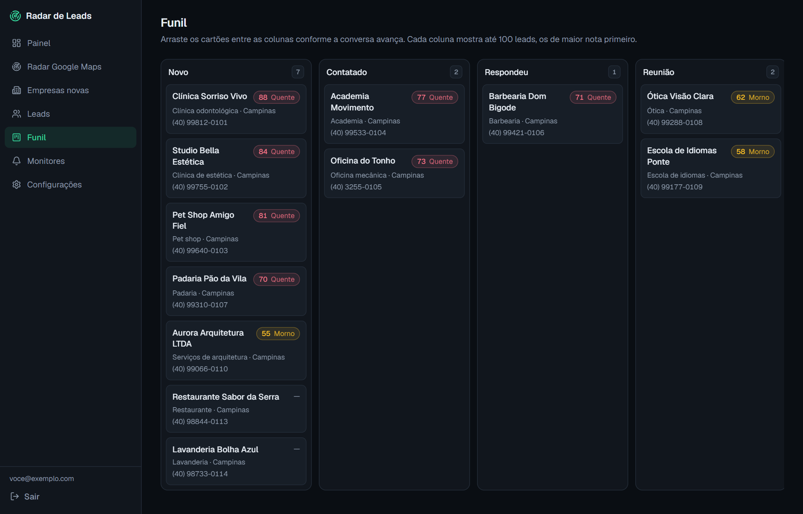
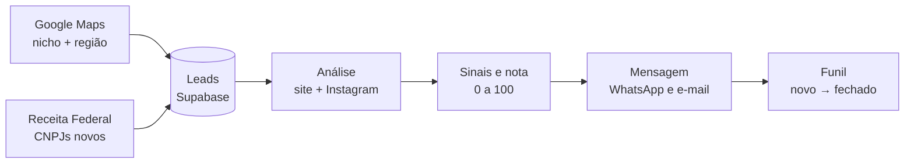

<div align="center">

# Radar de Leads

**Encontre negócios, descubra o que falta neles e aborde com a mensagem pronta.**

Ferramenta de prospecção para quem vende serviços a negócios locais: busca empresas no
Google Maps e na base de CNPJs da Receita Federal, analisa o site e o Instagram de cada uma,
dá uma nota de chance de compra e escreve a primeira mensagem de WhatsApp e e-mail.

[](https://github.com/GhostSouza145/radar-leads/actions/workflows/ci.yml)


[](LICENSE)



</div>

> As telas deste README usam dados fictícios.

## Sumário

- [O que faz](#o-que-faz)
- [Telas](#telas)
- [Como funciona](#como-funciona)
- [Fontes de dados e custo](#fontes-de-dados-e-custo)
- [Começando](#começando)
- [Deploy na Vercel](#deploy-na-vercel)
- [Como a nota é calculada](#como-a-nota-é-calculada)
- [Segurança](#segurança)
- [Limitações conhecidas](#limitações-conhecidas)
- [Estrutura do projeto](#estrutura-do-projeto)
- [Uso responsável](#uso-responsável)

## O que faz

| | |
| --- | --- |
| **Radar Google Maps** | Busca por nicho e região e traz telefone, site, nota e número de avaliações de cada negócio. |
| **Empresas novas** | Lista CNPJs abertos nos últimos 30 a 365 dias por atividade (CNAE) e cidade, com telefone, e-mail e sócios. |
| **Análise de presença digital** | Abre o site e o Instagram do lead e aponta as lacunas: sem site, site fora do ar, sem HTTPS, não adaptado ao celular, sem rastreamento, sem botão de WhatsApp, Instagram parado. |
| **Nota de 0 a 100** | Classifica cada lead em quente, morno ou frio conforme as lacunas encontradas e a facilidade de contato. |
| **Mensagem pronta** | Escreve a primeira abordagem de WhatsApp e de e-mail citando o que foi observado. Com IA ela é personalizada para o que você vende; sem IA sai de um modelo por regras. |
| **Funil** | Kanban de arrastar: novo, contatado, respondeu, reunião, fechado, perdido. |
| **Monitores** | Repete uma busca todo dia e guarda só o que apareceu de novo. |
| **Exportação e integração** | CSV pronto para o Excel e envio do lead para qualquer CRM por webhook. |

## Telas

| Lead: diagnóstico e abordagem | Lista de leads |
| --- | --- |
|  |  |



## Como funciona



1. **Busca.** Os resultados viram leads no banco. Um lead já existente nunca é sobrescrito, então o status e a análise feitos antes se mantêm.
2. **Análise.** O servidor visita o site do lead, extrai o que dá para verificar e procura o perfil do Instagram.
3. **Nota e mensagem.** Regras fixas geram os sinais e uma nota base. Se houver chave de IA, o modelo ajusta a nota à sua oferta e escreve o diagnóstico e as mensagens.
4. **Abordagem.** Um clique abre o WhatsApp com o texto preenchido e move o lead para "contatado".

## Fontes de dados e custo

| Fonte | Para quê | Chave | Custo |
| --- | --- | --- | --- |
| [Google Places API (New)](https://developers.google.com/maps/documentation/places/web-service/text-search) | Radar Google Maps | Sim | Cota gratuita mensal; exige conta de faturamento |
| [Serper.dev](https://serper.dev) | Alternativa ao Places | Sim | Créditos de teste sem cartão |
| [Minha Receita](https://minhareceita.org) | Empresas novas (CNPJ) | Não | Gratuito |
| Site do próprio lead | Análise de presença digital | Não | Gratuito |
| Prévia pública do Instagram | Seguidores, posts e bio | Não | Gratuito (melhor esforço) |
| [API da Anthropic](https://console.anthropic.com) | Diagnóstico e mensagens por IA | Opcional | Pago por uso |

As chaves são cadastradas na tela **Configurações** do app (ou por variável de ambiente). Sem chave de IA o app continua funcionando: a nota vem das regras e a mensagem de um modelo fixo.

## Começando

**Pré-requisitos:** Node.js 20 ou mais recente e um projeto no [Supabase](https://supabase.com) (o plano gratuito basta).

```bash
git clone https://github.com/GhostSouza145/radar-leads.git
cd radar-leads
npm install

cp .env.example .env.local   # preencha com os dados do seu projeto Supabase
npm run db:migrate           # cria as tabelas, as políticas e a trava de conta única
npm run dev
```

Abra `http://localhost:3000`. No primeiro acesso o app pede para criar a conta do dono; depois dela o cadastro fecha. Em seguida, preencha em **Configurações** o que você vende e a chave de uma fonte do Google Maps.

### Variáveis de ambiente

| Variável | Obrigatória | Descrição |
| --- | --- | --- |
| `NEXT_PUBLIC_SUPABASE_URL` | Sim | URL do projeto Supabase |
| `NEXT_PUBLIC_SUPABASE_ANON_KEY` | Sim | Chave pública (anon) |
| `SUPABASE_SERVICE_ROLE_KEY` | Sim | Chave de serviço, usada só no servidor (criação da conta e cron) |
| `POSTGRES_URL_NON_POOLING` | Para migrar | Conexão direta com o Postgres, usada por `npm run db:migrate` |
| `CRON_SECRET` | Em produção | Protege a rota dos monitores |
| `GOOGLE_PLACES_API_KEY`, `SERPER_API_KEY`, `ANTHROPIC_API_KEY` | Não | Alternativa às chaves salvas em Configurações |

### Scripts

| Comando | O que faz |
| --- | --- |
| `npm run dev` | Servidor de desenvolvimento |
| `npm run build` / `npm start` | Build e servidor de produção |
| `npm run lint` | ESLint |
| `npm run typecheck` | Gera os tipos de rota e roda o TypeScript |
| `npm run db:migrate` | Aplica `supabase/schema.sql` (pode rodar mais de uma vez) |

## Deploy na Vercel

[](https://vercel.com/new/clone?repository-url=https%3A%2F%2Fgithub.com%2FGhostSouza145%2Fradar-leads)

1. Importe o repositório na Vercel.
2. Adicione o Supabase pelo marketplace da Vercel (ele cria o banco e preenche as variáveis) ou informe as variáveis à mão.
3. Crie a variável `CRON_SECRET` com um valor longo e aleatório.
4. Rode a migração uma vez: `npx vercel env pull .env.local && npm run db:migrate`.

O arquivo `vercel.json` agenda os monitores para rodar uma vez por dia e fixa a região em São Paulo (`gru1`).

## Como a nota é calculada

As regras ficam em [`src/lib/analyze/signals.ts`](src/lib/analyze/signals.ts). Cada lead parte de 25 pontos e soma conforme o que foi observado (o total é limitado a 100):

| Sinal | Pontos |
| --- | --- |
| Sem site no perfil do Google | +24 |
| Site fora do ar | +22 |
| "Site" que é só rede social ou link na bio | +20 |
| Empresa aberta há até 60 dias / até 180 dias | +24 / +16 |
| Site não adaptado para celular | +10 |
| Nenhuma avaliação / menos de 20 avaliações | +9 / +7 |
| Site sem HTTPS, nota abaixo de 4 no Google | +8 cada |
| Celular disponível, Instagram parado há mais de 45 dias | +6 cada |
| Sem Analytics, sem Pixel, sem botão de WhatsApp, site lento ou desatualizado | +5 cada |
| Sem telefone nem e-mail | −15 |

A partir de 70 o lead é **quente**; de 45 a 69, **morno**; abaixo disso, **frio**. Com IA ligada, o modelo recebe essa nota como ponto de partida e a ajusta ao que você vende.

## Segurança

- **Isolamento por linha (RLS).** Todas as tabelas têm RLS ativo e só entregam linhas do próprio usuário. Sem login, a chave pública não lê nada.
- **Conta única.** Um gatilho em `auth.users` recusa qualquer cadastro depois do primeiro, inclusive chamadas diretas à API de autenticação do Supabase.
- **Segredos fora do repositório.** `.env*` está no `.gitignore`; só o `.env.example`, sem valores, é versionado.
- **Chaves de terceiros.** Ficam na tabela `settings`, protegida por RLS, e nunca voltam inteiras para o navegador (a tela mostra só o início e o fim).
- **Chave de serviço.** Usada apenas no servidor, em dois pontos: verificação e criação da primeira conta, e cron.
- **Cron.** A rota `/api/cron/monitors` exige `Authorization: Bearer $CRON_SECRET`.
- **Requisições de saída.** A análise de sites recusa endereços internos (localhost e faixas privadas), tem tempo limite e lê no máximo 600 KB por página.
- **Dados de terceiros na IA.** O conteúdo coletado dos sites é enviado ao modelo marcado como dado, não como instrução.
- **CSV.** Células que começam com `=`, `+`, `-` ou `@` são neutralizadas para não virarem fórmula no Excel.

Encontrou uma falha? Abra uma issue sem incluir dados sensíveis.

## Limitações conhecidas

- **Instagram em servidores.** A leitura de seguidores e posts usa a prévia pública do perfil e costuma ser barrada quando parte de datacenters (como a Vercel). Rodando localmente funciona melhor. Quando o Instagram barra, a análise segue sem esses números.
- **Base de CNPJ é mensal.** A Receita publica os dados uma vez por mês, então empresas abertas nos últimos dias podem ainda não aparecer.
- **Google Places devolve até 60 resultados por consulta.** As opções de varredura ampla dividem a cidade em uma grade para passar desse limite, ao custo de mais consultas.
- **Conta única.** O app foi desenhado para uso individual; não há times nem permissões.

## Estrutura do projeto

```text
src/
├── app/
│   ├── (app)/              telas autenticadas: painel, radar, empresas novas, leads, funil, monitores, configurações
│   ├── api/                buscas, análise, exportação, webhook e cron
│   ├── login/              login e criação da primeira conta
│   └── actions.ts          ações de servidor (leads, configurações, monitores)
├── components/             menu lateral, tabela de leads, selos de nota e sinais
├── lib/
│   ├── analyze/            análise de site e Instagram, sinais, IA e modelo de mensagem
│   ├── sources/            Google Places, Serper e base de CNPJ
│   └── supabase/           clientes de servidor e variáveis
└── proxy.ts                sessão e proteção das rotas
supabase/schema.sql         tabelas, índices, RLS e trava de conta única
scripts/migrate.mjs         aplica o schema
public/data/                listas de CNAEs e municípios (IBGE)
```

## Uso responsável

O Radar de Leads trabalha com dados públicos de empresas, mas a responsabilidade pelo uso é de quem opera:

- Respeite a LGPD e os termos de uso de cada fonte (Google Maps Platform, Instagram, Receita Federal).
- Use as mensagens para contatos individuais e relevantes. O app não faz disparo em massa, e não deve ser adaptado para isso.
- Pare de contatar quem pedir.

## Licença

[MIT](LICENSE)
